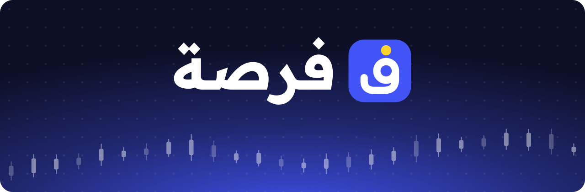
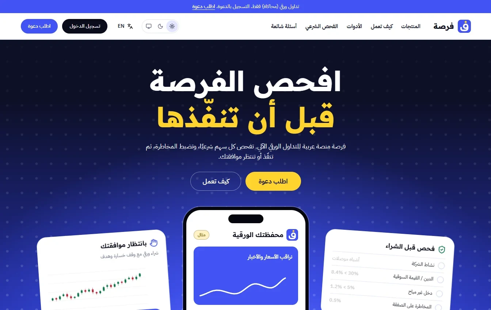
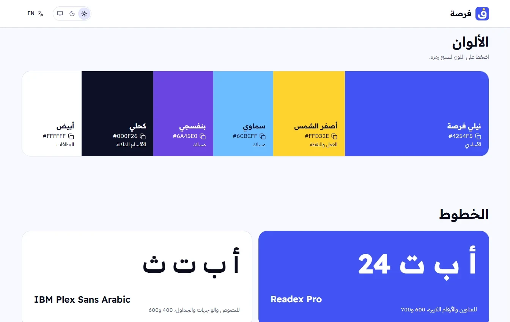

<p align="center"></p>

<div dir="rtl">

<h1 align="center">افحص الفرصة قبل أن تنفّذها</h1>

<p align="center">منصة عربية للتداول الورقي الآلي. تفحص كل سهم شرعيًا، وتضبط المخاطرة، ثم تنفّذ أو تنتظر موافقتك.</p>

<p align="center"><a href="#ابدأ-الآن">ابدأ الآن</a> · <a href="#كيف-تعمل">كيف تعمل</a> · <a href="#الضوابط">الضوابط</a> · <a href="#الهوية">الهوية</a> · <a href="#english">English</a> · <a href="#technical-reference">المرجع التقني</a></p>

> [!IMPORTANT]
> **تداول ورقي فقط.** كل الصفقات محاكاة، ولا يوجد في الشيفرة مسار يرسل أمرًا إلى وسيط. لا تَعِد المنصة بربح، والخسارة واردة حتى في المحاكاة، ومحتواها ليس نصيحة استثمارية.



## ما فرصة؟

تتابع فرصة أسعار السوق والأخبار، وتطلب من نموذج ذكاء اصطناعي اقتراحًا مشروحًا، ثم تمرره على فحص شرعي وحدود مخاطر ثابتة لا يستطيع النموذج تجاوزها. إذا اجتازها الاقتراح يصبح صفقة ورقية في محفظة افتراضية، مع وقف خسارة وهدف وسجل كامل لسبب القرار.

## كيف تعمل

| الخطوة | ما يحدث |
|---|---|
|  **تراقب** | أسعار وأخبار ومؤشرات محسوبة داخل المنصة من شموع مكتملة |
|  **تقترح** | صفقة مشروحة: السبب، ومتى يتغير الرأي، وسعر الوقف والهدف |
|  **تفحص** | الفحص الشرعي أولًا، ثم حدود المخاطر. نقص البيانات يمنع الشراء |
|  **تنفّذ أو تنتظرك** | صفقة ورقية، أو طلب ينتظر موافقتك بحسب اختيارك |

## المزايا

| الميزة | ما تقدمه |
|---|---|
|  **محفظة واحدة لعدة أسواق** | أسهم أمريكية وعملات رقمية فورية برصيد واحد وحدود واحدة |
|  **ساعات السوق** | متى يفتح السوق ومتى يغلق، والوقت المتبقي، مع العطل والإغلاق المبكر |
|  **مكتب الرسم البياني** | شموع وقمم وقيعان مؤكدة ودعم ومقاومة وأنماط، بلا رسم لاحق |
|  **اختيار الأسهم** | قواعد منشورة لمستثمرين معروفين: تجتاز أو لا تجتاز أو غير معلومة |
|  **فريق تحليل** | وكلاء مبنيون على Mastra يقرؤون الأدلة، وتُحذف أي جملة فيها رقم غير موجود فيها |
|  **أهداف وخطة محفظة** | توزيع على أهداف تحددها، بتنفيذ آلي أو بموافقتك أو اقتراحات فقط |
|  **رفيق تيليجرام** | تقارير وتنبيهات وأسئلة بالعربية. لا يضع أمرًا ولا يلغيه |
|  **منصة مستضافة بالدعوة** | لكل حساب محرك وقاعدة بيانات ومفتاح تشفير مستقل، ودخول بخطوتين |

## الضوابط

- **لا أموال حقيقية.** كل طلب إلى الوسيط قراءة فقط، ونقاط الأوامر والمراكز محجوبة ومغطاة باختبار.
- **الشرع قبل الشراء.** الدين والودائع أقل من 30% من القيمة السوقية، والدخل غير المباح أقل من 5% من الإيرادات، مع فحص النشاط. هذا فحص آلي أولي.
- **الحدود لا يتجاوزها الذكاء الاصطناعي.** خسارة يومية، وأقصى تراجع، وحجم مركز، ونسبة عائد إلى مخاطرة.
- **البيع لا يُمنع.** يمنع الفحص الدخول فقط، ووقف الخسارة يعمل حتى لو توقف الذكاء الاصطناعي.
- **لا بيانات مختلقة.** البيانات التجريبية موسومة بوضوح، ونقص البيانات يظهر كما هو.
- **المفاتيح سرية.** تُحفظ مشفرة ولا تعود إلى المتصفح ولا تظهر في السجلات.

## ابدأ الآن

تحتاج **Node.js 26 أو أحدث** وقاعدة **PostgreSQL** (ضع رابطها في `DATABASE_URL`). ثبّت المتطلبات، وابنِ الواجهة، ثم شغّل:

</div>

```powershell
npm install
npm run web:build
npm start
```

<div dir="rtl">

افتح <code dir="ltr">http://localhost:8787/app</code>. في المنصة المستضافة تتيح صفحة <code dir="ltr">/demo</code> تجربة بلا حساب: محفظة مؤقتة بأسعار تجريبية تُمسح بعد ساعتين على الأكثر (<code dir="ltr">SAAS_DEMO_MAX=0</code> يوقفها). لتجربة الواجهة بلا مفاتيح اختر البيانات التجريبية **DEMO** عند بدء الجلسة. المفاتيح وخطوات الإعداد كلها في [المرجع التقني](#technical-reference).

| الأمر | الغرض |
|---|---|
| `npm test` | كل الاختبارات |
| `npm run saas` | المنصة المستضافة (بدعوات) |
| `npm run web:dev` | تطوير الواجهة |
| `npm run replay` | إعادة تشغيل يوم سابق |
| `npm run predeploy` | الاختبارات وفحص الإعداد قبل النشر |

للنشر: [أي استضافة](DEPLOYMENT.md) أو [خادمك الخاص](DEPLOYMENT-VPS.md).

## بنية المشروع

| المجلد | المحتوى |
|---|---|
| [server](server) | المحرك وبيانات السوق والمخاطر والفحص الشرعي والتحليل وتيليجرام والمنصة المستضافة |
| [web](web) | الواجهة (Nuxt 4) بالعربية والإنجليزية |
| [public](public) | الطرفية الأصلية |
| [config](config) | الإعدادات الافتراضية وملف البحث المؤرخ |
| [test](test) | الاختبارات |
| [deploy](deploy) · [scripts](scripts) | النشر والنسخ الاحتياطي والأدوات |
| [docs](docs) | دليل الهوية ووثائق التصميم |

## الهوية

صفحة الهوية <code dir="ltr">/brand</code> فيها الشعار والألوان والخطوط والأيقونات جاهزة للتنزيل. [الدليل PDF](docs/brand/forsah-brand-identity-ar.pdf) · [كل الملفات ZIP](web/public/brand/forsah-brand-kit.zip)



<p align="center">
<picture><source media="(prefers-color-scheme: dark)" srcset="web/public/brand/forsah-ar-white.svg"></picture>
</p>

| اللون | الرمز | الاستخدام |
|---|---|---|
| نيلي فرصة | <code dir="ltr">#4254F5</code> | الأساسي |
| أصفر الشمس | <code dir="ltr">#FFD32E</code> | الفعل والنقطة، عُشر المساحة على الأكثر |
| سماوي | <code dir="ltr">#6CBCFF</code> | مساند |
| بنفسجي | <code dir="ltr">#6A45E0</code> | مساند |
| كحلي | <code dir="ltr">#0D0F26</code> | الأقسام الداكنة |

الخطوط: **Readex Pro** للعناوين والأرقام الكبيرة، و**IBM Plex Sans Arabic** للنصوص. لا يجتمع الشعاران العربي والإنجليزي في مساحة واحدة، ولا تُفصل النقطة عن الحرف. الأيقونات من Lucide برخصة ISC ([النص](web/public/brand/icons/LICENSE.txt)).

</div>

---

<p align="center"></p>

## English

**Forsah** (Arabic for *opportunity*) is an Arabic-first platform for automated **paper trading**. It follows prices and news, asks an AI model for an explained proposal, then puts it through a Sharia screen and fixed risk limits that the model cannot override. What passes becomes a simulated trade, with a stop, a target and a full record of why, or waits for your approval.

> [!IMPORTANT]
> **Paper trading only.** No code path places, changes or cancels a brokerage order. Every request to `*.alpaca.markets` must be a read-only `GET`, and order and position endpoints are blocked outright ([`server/util/http.js`](server/util/http.js), covered by a test). Nothing here promises a profit or is investment advice; losses are possible even in simulation.

**What is in it**

- One paper wallet for several US stocks and spot crypto, with market hours and countdowns
- Chart workspace, technical analysis, and stock picking by published investor rules
- Analysis team built with Mastra; sentences with numbers that are not in the evidence are dropped
- Sharia screen before every live-data entry, and four risk levels
- Saving goals and a portfolio plan that acts, asks first, or only suggests
- Arabic Telegram companion that can never place, change or cancel an order
- Invite-only hosted mode with a separate engine, database and key per account, and two-factor login

**Quick start:** Node.js 26+ and a PostgreSQL database (`DATABASE_URL`), then `npm install`, `npm run web:build`, `npm start`, and open `http://localhost:8787/app/`. Choose DEMO data to try it without keys. In hosted mode, `/demo` lets a visitor try it without an account: a separate temporary terminal with invented prices, no keys and no outside calls, erased within two hours (`SAAS_DEMO_MAX`, default 5 at once, `0` turns it off). Deploy on [any host](DEPLOYMENT.md) or [your own VPS](DEPLOYMENT-VPS.md). Run `npm test` for the tests.

**Brand:** the kit is at `/brand`; source files are in [`web/public/brand`](web/public/brand).

---

## Technical reference

Alpaca keys are used only for market data, news, the market clock/calendar and asset lookup. Open a section to read it.

<details>
<summary><b>1. Setup, keys and first session</b></summary>

Requirements: **Node.js 26 or newer** and **PostgreSQL** (tested on 19, UTF8). Put its address in `DATABASE_URL`. Without it the program does not start.

```powershell
npm install
npm start
```

Then open **http://localhost:8787** for the original terminal described below, or **http://localhost:8787/app/** for the Nuxt interface (build it once with `npm run web:build`).

The interface opens in **Arabic (right-to-left)** by default. Use the **العربية | English** switch in the top bar to change language instantly; the choice is remembered and also sets the language of new AI explanations.

1. Click **⚙ SETTINGS → CREDENTIALS** and enter:
   - **DeepSeek API key** (from platform.deepseek.com). Click **TEST** to check the key and list the available models.
   - **Alpaca API key ID + secret**. A free Alpaca **paper** account is enough for real-time IEX data. Click **TEST** to check them.
   - *(optional)* **SEC EDGAR User-Agent** as `Your Name you@example.com`. The SEC's fair-access policy requires this to query filings.
   - *(optional)* **Google Gemini API key**, if you choose Gemini instead of DeepSeek (Settings → AI → *AI provider*).
   - *(optional)* **Tiingo API token** for an extra overnight / extended-hours reference price.
   - *(optional)* **Telegram bot token** (from @BotFather) for the Telegram companion bot; then fill in **Settings → Telegram** (see section 12).

   You can put the same values in a `.env` file instead (copy `.env.example`). Environment values take precedence.
2. Type a ticker, for example **ANT**, and press **VERIFY**. The terminal checks the asset and loads historical candles, then subscribes to the live stream.
3. Enter the initial capital (e.g. **$500**) and an optional target (e.g. **$1,000**).
4. Press **▶ START AI TRADING**.

To try the interface without any keys, tick **DEMO data** before you press START. The terminal then runs on clearly labelled *synthetic* prices. Without a DeepSeek key, a DEMO session uses a transparent **RULES BASELINE (not AI)**.

Other commands:

```powershell
npm test
```

```powershell
npm run replay -- --symbol NVDA --date 2026-11-18 --decider rules --capital 500
```

</details>

<details>
<summary><b>2. What you see</b></summary>

> Layout (since the Arabic/RTL upgrade): a **top bar** (stock, price, market / data / AI status, trading controls, language switch), a **large central chart** (about 65-70% of the workspace on a 1920x1080 screen; ⇱ expands it to the full window, ⛶ enters fullscreen), a **resizable, collapsible side panel** (risk level, AI decision, AI chart explanation, portfolio, position, session setup, risk engine, scenarios, performance, news, DeepSeek usage) and a **resizable, collapsible bottom dock** (activity log, AI decisions, trade history, previous analyses, equity curve, indicators). In Arabic the side panel sits on the left (mirrored layout); the chart itself always runs left to right in time. The table below describes the panel contents.

| Area | Contents |
|---|---|
| **Header** | Symbol and company, real-time price and % change, timestamp of the last trade, market status (OPEN / PRE-MARKET / AFTER-HOURS / CLOSED / HALTED), data-status badge (e.g. `LIVE — ALPACA IEX`, `MARKET CLOSED — LAST PRICE`, `STALE DATA — TRADING PAUSED`, `CONNECTION LOST — RECONNECTING`; see section 4), AI status, session status, ET clock |
| **Left: AI Intelligence Center** | Status (AI Running / Paused / Waiting for Market Data / Market Closed / Market Halted / AI Error / Trading Disabled / Entries Paused), live request progress, action, confidence, trend, bias and sentiment, strategy, market interpretation, rationale, next planned action, evidence, bull / bear / base case, invalidation, uncertainty, news (source, publication and retrieval times, OFFICIAL / MEDIA / UNVERIFIED label, impact, AI sentiment, clickable link), DeepSeek web-research citations |
| **Center: chart** | TradingView Lightweight Charts v5.3: real candles plus volume in timeframes 1m / 3m / 5m / 15m / 30m / 1H / 1D. Overlays: EMA 9/21/50, SMA 20/50/200, VWAP, Bollinger Bands. Price lines for entry, stop and target, resting limit orders, breakout and breakdown levels, AI support/resistance and the expected range. BUY and SELL markers sit at the exact execution price; click one to inspect it. A strip below shows the data status (click it for the health checklist), bid / ask / spread, last trade and last quote with their exchange times and ages, last candle, session, connection health and source. A banner explains any non-live state, such as MARKET CLOSED with the last price, STALE DATA with the diagnosis, or **REAL-TIME MARKET DATA UNAVAILABLE** with the reason. |
| **Right: portfolio & controls** | START / PAUSE / RESUME / STOP / ANALYZE NOW / CLOSE PAPER POSITION / CHANGE STOCK / CHANGE CAPITAL / RESET (typed confirmation) / risk & AI settings. Capital-target progress, account figures, position (shares, average entry, stop, target, trailing stop, risk to stop), performance (trades, win/loss, win rate, average win and loss, profit factor, max drawdown, fees, buy & hold), risk-engine state, DeepSeek usage (requests, input and output tokens, estimated spend, remaining budget, latency) |
| **Bottom left: AI LIVE ACTIVITY** | Every real application event with timestamp, colour-coded category, status, message and data source. Filterable; exports to JSON. |
| **Watchlist (side panel, top)** | Every monitored symbol: price, % change, trend, last AI decision, open position and unrealized P&L, data source and freshness. Click a row to show that symbol on the chart; ❚❚ / ▶ pause or resume its AI monitoring; ✕ removes it (refused while it has a position or a pending order). Positions of all symbols appear under *Open positions* in the portfolio section. |
| **Bottom right** | **AI Decision Explanations** (click for the full observable audit: triggers, data sent, indicators, news, AI request status, final proposal, each risk check pass/fail, execution result). **Equity curve vs buy & hold.** **Trades** (CSV export). **Indicators** (live values, with "unavailable" shown where data is insufficient). |

</details>

<details>
<summary><b>3. Architecture</b></summary>

```
public/                      original HTML/CSS/JS terminal (no secrets ever reach the browser)
  index.html, css/terminal.css, js/{i18n,i18n-messages,util,explain,chart,settings,app}.js
server/
  index.js                   entry point (.env loader)
  app.js                     Express + WebSocket server, localhost-only, CSRF/Host/Origin checks
  engine/agent.js            orchestrator: data → analysis → AI → risk → execution → persistence
  engine/replay.js           deterministic replay harness (virtual clock, no look-ahead)
  market/alpaca.js           Alpaca connector (REST GET + WebSocket, reconnect, heartbeat)
  market/candles.js          candle builder (official minute bars + genuine trade prints only)
  market/marketState.js      quotes, trades, halts, freshness / stale-data detection
  market/session.js          NYSE/Nasdaq session calendar (Alpaca calendar, DST-safe)
  market/demo.js             DEMO synthetic provider (labelled, never produces news)
  market/replay.js           historical replay provider
  analysis/indicators.js     SMA/EMA/RSI/MACD/ATR/Bollinger/VWAP/volume (shared with the browser)
  analysis/structure.js      swings, support/resistance, session levels, consolidation, trend
  analysis/signals.js        breakout / breakdown / failed breakout / reversal / pressure / volume…
  analysis/technicals.js     confirmed swings, S/R zones, break events, trend lines, ranges, candle patterns (shared with the browser)
  analysis/chartAnalysis.js  AI levels cross-checked against app levels, proposed plan, decision change
  trading/riskProfiles.js    the four risk levels (presets) and CUSTOM detection
  analysis/snapshot.js       structured market snapshot sent to the AI
  ai/deepseek.js             DeepSeek client (streaming, thinking control, JSON mode, web tools)
  ai/prompt.js, proposal.js  prompts, strict output validation
  ai/scheduler.js            trigger queue: one analysis at a time, dedupe, cooldowns
  ai/usage.js                token/cost accounting, daily budget, requests-per-minute limit
  ai/decider.js              DeepSeek decider + RULES BASELINE (DEMO/REPLAY only)
  news/{sources,collector}.js Alpaca News, SEC EDGAR, Federal Reserve, Nasdaq halts, custom RSS
  trading/risk.js            deterministic risk engine + position sizing
  trading/execution.js       fill simulator (bid/ask, slippage, liquidity tiers, partial fills, fees)
  trading/portfolio.js       cash-account accounting (long-only)
  trading/orders.js          stop-loss / take-profit / trailing stop / resting limit orders
  trading/metrics.js         performance statistics
  db.js, secrets.js, config.js, activity.js
config/default.json          non-secret defaults (risk limits, pricing, polling…)
test/                        automated tests (node:test)
scripts/replay.js            historical replay CLI
data/                        encryption key files, replays (git-ignored)
```

**Decision flow.** A trigger fires: a candle closes, a key level breaks, volume spikes, news breaks, the risk state changes, price nears the stop or target, or the regular interval passes. The scheduler queues the trigger, coalesces it with others and rate-limits it. The agent then builds a snapshot from **completed real bars only** and stores it. The AI request is sent only if it fits the requests-per-minute limit and the daily budget. The reply is validated strictly: it must be JSON, use known enums, have consistent levels, reference the correct snapshot ID and contain plausible prices. Next comes the risk engine (§6). Only then does the simulator fill against the live bid/ask, and the portfolio, protective orders, database and UI update.

The chart and market data never wait for the AI, and only one analysis runs at a time, so overlapping requests can never produce conflicting trades.

</details>

<details>
<summary><b>4. Market data (Alpaca), and what that honestly means</b></summary>

| Setting `market.feed` | Label | Meaning |
|---|---|---|
| `iex` (default, free) | `LIVE — ALPACA IEX` | Real-time trades and quotes from **the IEX exchange only**. Prices are genuine prints, but IEX carries a small share of US volume, so volume and relative volume are partial and the IEX quote is not the full national best bid/offer. |
| `sip` | `LIVE — ALPACA SIP` | Real-time consolidated tape from all US exchanges. Requires Alpaca's paid **Algo Trader Plus** plan; without it, Alpaca returns *insufficient subscription* and the terminal shows that error. |
| `delayed_sip` | `DELAYED — 15 MINUTES (ALPACA SIP)` | Charts update, but **simulated execution is disabled** because the quotes are not current. |

How the data is handled:

- **Candles.** History and the live stream use the same feed and `split` adjustment. Timestamps are UTC internally and shown in ET. The forming candle is built from real trade prints and replaced by Alpaca's official minute bar (and `updatedBars` corrections). A minute with no trades has no candle. Nothing is interpolated or invented.
- **Separate evidence, separate timestamps.** The terminal tracks each of these on its own: WebSocket connected, authenticated, subscription *confirmed by Alpaca* for the symbol's trades/quotes/bars, heartbeat (ping/pong), last trade, last bid/ask quote, last minute candle. Data **age is measured from the exchange timestamp**. Receipt time is used only for connection diagnostics, so an open socket never makes old data look fresh. The last trade is never used as a bid or ask.
- **Execution-quality data.** A simulated order needs a subscribed real-time stream and a valid bid/ask **delivered by the stream** whose exchange timestamp is at most 15 s old (`market.maxQuoteAgeMs`). Snapshot (REST) quotes are shown, but are never used for execution. Otherwise the risk engine refuses the order and says why, and stops stay armed until reliable data returns.
- **Market sessions.** The official Alpaca **clock** (`/v2/clock`, refreshed every 5 min and at every session change) and **calendar** (`/v2/calendar`: holidays, early closes) are used in America/New_York time, with DST. The clock overrides the calendar for the regular session, for example on an unscheduled closure, and also reveals a wrong local clock. A weekday estimate (marked `*`) is used only if both fail.
- **IEX coverage hours.** The IEX exchange itself only trades 08:00–09:30 (pre-market), 09:30–16:00 and 16:00–17:00 ET (post-market). Outside those hours the free IEX feed has no data, even when the wider market is in its 04:00–20:00 extended session, so that silence is shown as closed for the feed, not as a failure. Configure this in `market.feedCoverage`.
- **Status shown, not spammed.** One status pill (header and data strip; click it for the full health checklist) shows: `LIVE — ALPACA IEX`, `MARKET CLOSED — LAST PRICE`, `AFTER-HOURS — NO IEX DATA (LAST PRICE)`, `PRE-MARKET — NO RECENT IEX QUOTE`, `CONNECTED — WAITING FOR MARKET DATA`, `STALE DATA — TRADING PAUSED`, `CONNECTION LOST — RECONNECTING`, `TRADING HALTED`, `DELAYED`, or `REAL-TIME MARKET DATA UNAVAILABLE`. The activity log records a status **once when it changes**, plus a reminder only if a problem is still unresolved after 5 minutes (`market.statusReminderMin`). Repeated identical errors, reconnect attempts after the 3rd, and minutes without trades are summarised the same way.
- **Why no fresh quote?** While the feed should be active but no current quote arrives, the terminal compares the stream with REST snapshots of the symbol and of SPY, at most once a minute. It reports one of three findings: *the stream is not delivering updates that REST has*, which forces a rate-limited reconnect; *this stock currently has little or no activity on IEX*; or *the whole feed is quiet*.
- **Reconnection and recovery.** Reconnects use exponential backoff with jitter, capped at 30 s while the market is open and 5 min while it is closed. After reconnecting, the stream re-authenticates and re-subscribes, and Alpaca's subscription confirmation is checked. Missing 1-minute candles are fetched from REST, the latest trade/quote is refreshed, and the status stays `CONNECTED — WAITING FOR MARKET DATA` until the first live message proves data is flowing. When the feed's hours begin (08:00 ET on IEX), the terminal reconnects immediately if it was waiting, re-verifies the subscription and back-fills candles. On a new trading day it loads the new day's window. An authentication failure is fatal and does not cause a reconnect storm. A *connection limit exceeded* error (another app using your one free stream) retries with a long backoff.
- **Halts.** Halts come from Alpaca's trading-status channel when your plan provides it, and from Nasdaq Trader's official trade-halt RSS feed otherwise.
- **Market closed.** The chart keeps the last real candles and shows the last price with its timestamp. No candles are generated and no per-minute updates are expected. Scheduled AI calls pause to save budget.
- **Broad market.** SPY and QQQ snapshots are included in every AI snapshot.

</details>

<details>
<summary><b>5. DeepSeek integration (checked against api-docs.deepseek.com on 2026-11-19)</b></summary>

- **Models.** `deepseek-flash` (default; served by DeepSeek-V4.1-Flash) and `deepseek-v4-pro`. The settings dropdown is filled live from `GET /models`. `deepseek-chat` and `deepseek-reasoner` were discontinued on 2026-07-24 and are not used.
- **Reasoning effort.** `none` / `low` / `high` / `max`, sent as `thinking:{type}` plus `reasoning_effort`. The model's hidden reasoning (`reasoning_content`) is **never displayed or stored**; only its size is counted. Live progress shows "reasoning (hidden) · N chars", then the structured answer.
- **JSON output.** Uses `response_format: {"type":"json_object"}` and validates the result strictly. A blank or truncated reply (`finish_reason: length`) is reported as an error with a hint.
- **Web research.** Uses the official server-side tools `deepseek_web_search` and `deepseek_read_url` on `deepseek-flash`. The docs say these cannot be combined with JSON mode, so research runs as a separate text call: at most every 30 min (configurable), or when news breaks. Its citations appear in the UI marked "unverified by app" and are passed to the decision call as untrusted content.
- **Costs.** Estimated from the documented peak / off-peak prices in `config/default.json → pricing`. Each request is checked against **max requests per minute** and the **daily USD budget** before it is sent. Errors 401 (invalid key), 402 (insufficient balance), 429 and 5xx are mapped to clear messages; 401 and 402 pause the AI, and protective orders keep running.
- **Untrusted content.** News and web text are fenced as `untrusted_external_content`. The system prompt tells the model to ignore instructions inside them, and nothing the AI says bypasses validation and the risk engine.

</details>

<details>
<summary><b>6. Risk engine and simulated execution</b></summary>

#### Risk level (one control)

The side panel's **مستوى المخاطرة / Risk level** selector sets every profile-controlled limit of the deterministic risk engine at once. These are configurable paper-trading presets, not investment advice and not "safe" settings:

| Limit | Conservative (منخفضة) | Balanced (متوسطة, default) | Aggressive (مرتفعة) | Very aggressive (مرتفعة جدًا) |
|---|---|---|---|---|
| Max risk per trade | 0.25% | 0.5% | 1% | 2% |
| Max daily loss | 1% | 2% | 3% | 5% |
| Max portfolio drawdown | 5% | 8% | 12% | 20% |
| Max single-position allocation | 10% | 20% | 30% | 50% |
| Min reward : risk (after costs) | 2.0 | 1.8 | 1.5 | 1.2 |
| Max simultaneous positions | 1 | 2 | 3 | 4 |
| Max stop distance | 3% | 5% | 8% | 12% |
| Loss streak -> cooldown | 2 -> 60 min | 3 -> 30 min | 4 -> 20 min | 5 -> 15 min |
| Max entries per day | 4 | 8 | 12 | 20 |

- The "max simultaneous positions" limit applies to all monitored symbols together, because they share one portfolio.
- **Show advanced settings** reveals the individual values. Editing any of them marks the level **Custom (مخصص)**; editing them back to a preset's exact values selects that preset again.
- **Per-trade risk is computed, not assumed:** entry (ask + slippage) minus stop, plus expected stop slippage, commissions, SEC fee and FINRA TAF, times the quantity. The engine records explicit `risk_per_trade` and `max_allocation` checks before any simulated order. Allocation (% of capital in the position) and risk (loss if the stop is hit) are separate limits.
- **Switching levels while trading:** the new limits apply to new trades immediately; daily-loss and drawdown are re-checked at once. Existing positions are **never sold automatically**: an exposure review explains what exceeds the new limits (allocation, risk to stop, stop distance, daily loss, drawdown) and how many shares would have to be sold, and the user can confirm a reduction. Protective stops stay active and pending limit orders are re-validated before they can fill.
- Every fill records the risk level in force when it was executed. The AI receives the level and its limits in every snapshot and cannot override them.
- **Existing installations:** a stored configuration that already had individual risk overrides keeps its effective limits and shows as **Custom** until a level is chosen. A fresh installation starts on **Balanced**.

The remaining limits (spread, slippage, minimum stop distance, IPO mode) are edited in **Settings -> Risk**. The original pre-profile defaults were:

| Limit | Default |
|---|---|
| Max risk per trade | 1% of equity |
| Max daily loss | 3% (pauses new entries for the day) |
| Max drawdown | 10% from peak (disables trading until you clear it or raise the limit) |
| Max single-position allocation | 25% |
| Consecutive losses → cooldown | 3 losses → 30 min |
| Max spread / max slippage | 0.5% / 0.3% |
| Min reward : risk (after estimated costs) | 1.5 |
| Max entries per day | 10 |
| Min stop distance | 0.15% and 2× the spread |

Rules the AI cannot override:

- **Proposal freshness.** A proposal older than 120 s, or one where price has moved more than 0.5% since its snapshot, is invalidated and re-assessed.
- **Duplicates.** An identical proposal executed within the last 10 minutes is rejected.
- **The capital target never increases risk.** The target and its progress bar are informational only.
- **Position sizing.** The smallest of four limits wins: the risk budget, the allocation cap, available cash, and the AI's requested size.
- **Small accounts.** With $500 and a 25% cap, a single position is limited to $125. Without fractional shares (off by default; Settings → Execution), stocks above $125 cannot be bought, and the risk engine says so explicitly.
- **Long only.** No short selling, leverage, margin or options.

Fills are simulated against the live quote:

- Buys lift the **ask** and sells hit the **bid**. Market orders add base slippage of 2 bps by default.
- Liquidity is modelled in tiers of the displayed size. Each further tier walks the price, up to the slippage cap or the limit price; any remainder becomes a **partial fill**.
- SEC Section 31 and FINRA TAF fees apply to sells; verify the current rates in Settings. Commissions are configurable.
- Outside regular hours, only LIMIT orders are allowed, and only when extended hours are enabled.
- Halts block fills.

Protective orders are evaluated on every real trade and quote, independently of the AI, and keep working while the AI is **paused or stopped**:

- Stop-loss (fills at the bid, so gaps fill worse)
- Take-profit
- Trailing stop
- Resting limit entries for "waiting for pullback", with expiry

**STOP AI** cancels pending entries but never silently discards a position.

**Strategies.** The AI chooses one of: momentum, breakout, support bounce, resistance rejection, VWAP, trend following, pullback, mean reversion, news-driven, or opening-range breakout. The app supplies deterministic evidence for each: detected signals, levels, opening range and VWAP. None of these strategies is assumed to be profitable, and "no trade" is a normal outcome.

</details>

<details>
<summary><b>6a. Chart technicals and AI annotations</b></summary>

All chart annotations are computed by the application from **completed real candles** (`server/analysis/technicals.js`, shared by the server and the browser):

- **Swing highs / lows** (pivot with 3 candles on each side), labelled higher high / lower high / higher low / lower low. A swing is only shown as confirmed after the 3rd candle after it closes, with that confirmation time; a newer unconfirmed candidate is drawn as a dashed "?" circle. Confirmed swings are never repainted by later data (tested).
- **Support / resistance zones** from clustered confirmed swings, the previous session's high/low and volume concentration (when at least 50 candles exist), labelled support 1/2 and resistance 1/2, with strength estimate, confirmed reactions, visits, last interaction, and active / broken status. Click a zone label for details.
- **Breakouts / breakdowns**, only against swing levels confirmed before the breaking candle, with the volume ratio.
- **Trend lines** through the last two confirmed swing lows / highs, and **trading-range** boxes.
- **Candlestick patterns** (hammer, shooting star, doji, bullish/bearish engulfing, morning/evening star) are labelled only when their stated mathematical conditions hold; the next candle's confirmation (or failure) is recorded with its time.
- **Candle inspector:** hover a candle for OHLCV; click it for body/wick sizes, the nearest level, patterns at that candle and a plain-language explanation built from its numbers.

The **AI** receives these values in every snapshot (full detail for the analysis timeframe, a compact summary for the others), plus its **previous analysis**, the **risk level** and capital at risk. It must base chart observations on them, may choose WAIT / NO TRADE, and fills `decision_change` (why its decision changed or still holds) and `chart_explanation` (trend, swings, levels, candles, volume, entry and exit conditions). Every AI price level is cross-checked against the application's levels: matches are drawn as verified, others as dotted "unverified". AI levels later broken by a closing candle are greyed as invalidated. Proposed entry / stop / target are drawn as dashed boxes, never as executions. Executed trades are solid arrows; the real position's stop and target are solid lines; pending limit orders are dotted amber lines; the AI's expected range is a dotted "forecast" line. The chart redraws annotations locally; DeepSeek is never called just to redraw.

The **Chart layers** menu toggles highs/lows, support/resistance, trend lines & ranges, breakouts, candlestick patterns, executed trades, AI decisions, stop-loss and take-profit levels, moving averages (each one), momentum (RSI pane) and volume, with *Clean* and *Detailed* presets. The choice is stored in the browser. The **Previous analyses** tab keeps the history of AI assessments separate from executed trades.

</details>

<details>
<summary><b>7. News</b></summary>

| Source | Status |
|---|---|
| Alpaca News API (Benzinga newswire) | ✔ uses your Alpaca keys; headline and summary only |
| SEC EDGAR filings (8-K, S-1, 424B4, 10-Q…) | ✔ needs `SEC_USER_AGENT`. Newly listed tickers can take days to appear in SEC's ticker map; set the CIK override in Settings → Data & News |
| Federal Reserve press releases (monetary policy) | ✔ official RSS |
| Nasdaq Trader trade halts | ✔ official RSS; also feeds halt detection |
| Company investor-relations feed | ✔ add it as a custom RSS feed marked `official` |
| Reuters / AP | ✘ **not connected**: no public licensed API. Add a licensed feed under custom feeds if you have one. |

For every item the terminal records the source, publication time, retrieval time, relevance score and reason, duplicate detection (URL plus title similarity), verification class, estimated impact, and what was actually retrieved (headline / summary / filing metadata). The AI's bullish / bearish / neutral assessment is shown next to each item. News is never invented. Significant fresh news triggers a re-evaluation, subject to a cooldown and the API limits.

</details>

<details>
<summary><b>8. ANT (Anthropic) and newly listed stocks</b></summary>

`config/default.json` keeps a labelled reference for ANT: listed on Nasdaq on 2026-11-19 at an $83 offer price. This is **reference information only**; the live price always comes from the feed. For a stock with fewer than 5 daily bars, **IPO mode** turns on automatically:

- Long-term indicators such as the daily SMA200 are marked *unavailable* and never fabricated.
- Entries must wait 15 minutes after the first regular-session trade.
- The maximum spread is tightened.
- ATR as a percentage of price must stay within a limit.
- The allocation cap is halved.

If the IPO has not opened yet, VERIFY reports that no trades exist yet.

</details>

<details>
<summary><b>9. Security and persistence</b></summary>

**Security**

- Locally the server binds to **127.0.0.1**. In production (`NODE_ENV=production`) it binds to `0.0.0.0:$PORT` and **requires a login** (section 13). Host and Origin checks block DNS rebinding and cross-site requests.
- Mutating API calls require a custom header, which forces a CORS preflight that the server never approves.
- The CSP disallows external scripts.
- Keys entered in the UI are **encrypted at rest** (AES-256-GCM, key in `data/master.key` or `TERMINAL_MASTER_KEY`). They are never sent back to the browser (masked only) and are redacted from logs. This protects against casual disclosure, not against someone with full access to your Windows account.
- `data/` and `.env` are git-ignored.

**Persistence** (PostgreSQL: `DATABASE_URL`; key files in `DATA_DIR`)

- Stored: settings, sessions with portfolio, orders, risk and benchmark state, fills, AI decisions with audit trails, market snapshots, news references, activity log, equity curve, and AI usage.
- On restart the active session is restored. If the AI was running, it resumes; disable this with `session.autoResumeAi`.
- Exports: **trades CSV** (guarded against spreadsheet formula injection) and **activity + decisions JSON**.

</details>

<details>
<summary><b>10. Testing and replay</b></summary>

`npm test` runs the whole suite on the disposable PostgreSQL server in `PG_TEST_URL` (required) (sections 12 and 13 list what the November 2026 upgrades added; `test/production.test.js` and `test/providers.test.js` cover the production / dual-AI work). Besides the list below they cover risk levels and their enforcement, the no-auto-liquidation exposure review, look-ahead-free swings and break events, candlestick pattern conditions, AI-level verification, the Arabic prompt rules, and Arabic translation coverage of every activity message produced by the engine scenarios. The original suite covers:

- Indicators, structure and signals
- Portfolio accounting identities, and long-only / no-margin enforcement
- Order execution, partial fills, fees and limit orders
- Position sizing, stop-loss, take-profit and trailing behaviour
- Daily-loss, drawdown and cooldown limits
- Data freshness and staleness, halts, session calendar and DST
- Market-data health: regular hours, pre-market before and after IEX opens, after-hours past 17:00 ET (the reported flood case), weekends, holidays, early closes, the Alpaca clock override, disconnection and recovery with candle back-fill, missing quotes while trades flow, a symbol quiet on IEX, a stream missing updates, unconfirmed subscriptions, closed-market backoff, and **no repeated warnings**
- Candle building without invented bars
- The Alpaca WebSocket protocol: auth, subscribe, parsing, **disconnect → automatic reconnect → resubscribe**, fatal auth failure
- The paper-only guard
- AI JSON validation and duplicate proposals
- The DeepSeek SSE client and error mapping, scheduler non-overlap, budget and rate limits
- Database and encrypted-key persistence
- Server security
- End-to-end engine flows, including a full **LIVE code path over mocked Alpaca REST + WebSocket** and the IPO case
- Deterministic **replay with no look-ahead** for candles and news

`npm run replay` downloads a past day's real Alpaca minute bars and news and replays them through the same engine with a virtual clock.

- Fills in replay assume the bar's OHLC path and a fixed spread, because historical quotes are not replayed. This assumption is labelled.
- With `--decider deepseek`, the app prevents data look-ahead, but an LLM may still know about past events from its training.
- A few simulated trades say nothing reliable about profitability. Every metrics view carries that warning until there is a meaningful sample.

</details>

<details>
<summary><b>11. Limitations and what was not verified</b></summary>

- **Not run against live services.** The real Alpaca and DeepSeek services were not exercised during development because no credentials were available. Both connectors are built from the current documentation and tested against local mock servers that speak the documented protocols. The first live run is your acceptance test, and any provider error is shown in the Activity panel.
- **Alpaca quote sizes.** The stream docs say round lots; the REST docs say shares since 2025-11-03. The default is `shares`; switch to `round_lots` in Settings if fills look off.
- **Halt channel.** Whether Alpaca's trading-status channel is available on the free IEX feed is undocumented. The terminal falls back to the Nasdaq halts RSS.
- **Fee rates.** SEC and FINRA fee rates change over time; check the current values.
- **Several symbols, one portfolio.** Up to `market.maxSymbols` symbols (default 10) are monitored at once over one shared WebSocket. They share one cash balance, and the risk level's "max simultaneous positions" applies to all of them together. AI analyses run one at a time, so two symbols can never spend the same cash.
- **Language of stored text.** The server keeps its logs, exports and audit trail in English; the browser translates them through a message catalog (`public/js/i18n-messages.js`). A message the catalog does not know is shown in its original English, left to right. AI explanations are written in the language selected when the analysis ran, so older analyses keep their original language after you switch. News headlines are shown as published by the source; the AI's assessment of each item appears in the selected language.
- **Doubling is not expected.** The +100% target is an objective, not a promise. Expect many WAIT / NO TRADE decisions, and losses are possible even in simulation.

</details>

<details>
<summary><b>12. November 2026 upgrade: watchlist, overnight data, AI cost control, Telegram</b></summary>

#### Multi-symbol watchlist and one shared portfolio

- Add symbols from the **Watchlist** panel (or Telegram `/addstock`). Each symbol has its own candles, indicators, AI analysis, levels, decisions and data-freshness state. All symbols share **one** WebSocket connection and **one** virtual portfolio: same cash, same risk limits, same accounting for the web dashboard and Telegram.
- The session's first symbol is the *main* symbol. It cannot be removed, but its monitoring can be paused.
- Removing a symbol never closes a position. It is refused while the symbol has an open position or a pending order, and its trade history is kept.
- Pausing a symbol stops new AI analysis and new entries for it. Market data, stop-loss, take-profit and trailing stops keep running.

#### Orders ledger and trade history

- Proposals, orders, executions and positions are stored separately. Every order has its own id and status: `PENDING`, `PARTIALLY_FILLED`, `FILLED`, `REJECTED` (with the risk-engine reason), `CANCELLED` or `EXPIRED`. Every fill links to its order.
- Fills recorded before the upgrade are migrated once to `FILLED` orders with ids `ord_m_<fillId>`.
- The **Trade history** tab switches between *Executions* and *Orders* and filters by symbol, period, BUY/SELL, profit/loss, strategy and order status. The CSV export applies the same filters.

#### Extended hours and overnight

- The calendar knows pre-market (04:00–09:30 ET), regular hours, after-hours (16:00–20:00) and the **overnight** session (20:00–04:00, Sunday to Thursday nights before a trading day), including DST, weekends, holidays and early closes.
- Overnight prices come from the Alpaca `overnight` snapshot feed (free plans: indicative quotes and 15-minute-delayed trades), or from Alpaca BOATS on a paid plan, then from Tiingo as a fallback. They are polled over REST, because Alpaca's overnight WebSocket was reported inactive.
- Each price is labelled **LIVE TRADE DATA**, **LIVE QUOTE DATA**, **INDICATIVE PRICE**, **DELAYED DATA**, **MARKET CLOSED**, **DATA UNAVAILABLE**, or **SYNTHETIC DATA (DEMO)** / **HISTORICAL REPLAY**. A reference price is shown next to the main price and is never used as a trade print or for a simulated fill.
- Overnight simulated execution stays **suspended** (`execution.overnight`), because the free sources carry no execution-quality quotes.
- The chart's **Extended & overnight hours** layer shows or hides non-regular bars. Pre-market and after-hours are shaded amber; overnight is shaded purple. Overnight candles come only from actual Alpaca BOATS minute bars (delayed on free plans) and are drawn in a muted purple.

#### AI cost control (DeepSeek or Gemini)

- **Usage modes**, all with identical risk protections:
  - **ECONOMY**: review hourly, at most 2 analyses per symbol per hour and 40 per day, no candle-close trigger, no web research.
  - **BALANCED** (default): review every 20 minutes, up to 150 per day.
  - **DETAILED**: review every 5 minutes, up to 500 per day.
- Monitoring, indicators and risk checks run locally. The AI is called only on events (news, level break, near stop or target, position change, risk change, invalidated thesis) or on the review schedule.
- A **persistent per-symbol cache** stores the last analysis together with a hash of the material market state. If nothing material changed, the cached analysis is reused and the avoided request is counted. Forced triggers always analyse.
- News items already processed are not sent again.
- Limits: per-symbol hourly, daily cap, daily budget and monthly budget. After an API error the AI backs off exponentially. While the AI is unavailable, monitoring and protective orders continue but no new AI decisions are made.
- The **AI usage** tab shows today/month requests, tokens, estimated spend, remaining configured budget, requests avoided by the cache, last analysis, API status and recent errors. The budget is a spending cap you set; it says nothing about free quota at the provider.

#### Telegram companion bot (Arabic)

Setup:

1. Create a bot with @BotFather.
2. Save the token in **Settings → Credentials**. It is encrypted, never sent to the browser and redacted from logs.
3. In **Settings → Telegram**, enable the bot and enter the authorized chat IDs and user IDs. In a group, sensitive commands also require an authorized **user** id.
4. Press **Test connection**.
5. Restart the app if the bot does not start.

Commands (also available as buttons from `/start`):

| Command | Purpose |
|---|---|
| `/start`, `/help` | Main menu, command list |
| `/portfolio` | Cash, equity, P&L, exposure, positions (stale valuations are labelled) |
| `/buys`, `/sells`, `/orders`, `/trades` | Executed buys and sells, orders with status, trade log |
| `/stats` | Statistics by period (today, week, month, 7/30 days, all); "insufficient data" instead of invented numbers |
| `/daily`, `/weekly`, `/monthly` | Reports, also scheduled at the configured time and timezone |
| `/stock T`, `/watchlist`, `/addstock T`, `/removestock T`, `/pause T`, `/resume T` | Symbol details and watchlist management |
| `/ai`, `/decisions` | AI status and usage, recorded decisions with their stored rationale |
| `/risk` | Risk level. Changing it shows its effects first and needs confirmation; it never closes positions silently |
| `/status`, `/pauseai`, `/resumeai`, `/stopai` | System status and AI controls (authorized, confirmed, executed once, verified, audited) |
| `/notifications`, `/settings` | Current notification and bot settings (read-only in the bot) |

Free-text Arabic questions such as «كم ربحي اليوم؟» or «ليش باع سهم NVDA؟» go through a **deterministic intent parser**. It answers from the database and the stored rationale. No AI-generated SQL is used, and no AI call is made for routine questions or notifications.

Notifications (fills, order rejections, proposals, risk limits, AI pauses and errors, news, data status, and optionally sessions, watchlist changes and breakouts) go through a persistent queue with idempotency keys, de-duplication, retries, rate limiting and delivery status. Fills, risk-limit hits and AI-error pauses are mandatory while notifications are enabled.

The bot can never place, change or cancel an order, and the whole platform never sends anything to a brokerage.

#### New database tables

`orders`, `watchlist`, `ai_cache`, `ai_avoided`, `tg_notifications`, `tg_audit`, `tg_nonces`, `tg_state`, plus an `orderId` link on fills (migrated automatically and safely on first start).

#### New tests

The upgrade added these suites:

- `test/multisymbol.test.js`: shared stream, cash and position limit; watchlist safeguards; AI cache; usage modes and limits; state hash; Gemini client; overnight labelling; reporting periods; data-kind labels; news, data-reliability and breakout events.
- `test/telegram*.test.js`: authorization, confirmations and replay protection, callback validation, notification queue and de-duplication, Arabic intents, report scheduling, token redaction, and the bot running against the real engine.

**Not verified:** none of Gemini, Tiingo, Alpaca overnight/BOATS or Telegram was called live, because no credentials were available. Those connectors are tested against faked HTTP responses that follow the providers' documentation.

</details>

<details>
<summary><b>13. Production architecture (always on)</b></summary>

The browser is **only a view**. One Node.js process is the single authoritative backend. It contains:

- the web server, REST API and WebSocket;
- the market engine: the Alpaca stream, the overnight/extended-hours reference prices, candles and
  indicators;
- the AI Provider Manager;
- the risk engine and paper execution;
- the one shared portfolio;
- the Telegram bot;
- scheduled reports, backups and retention.

Opening a dashboard never starts an engine. Closing every tab stops nothing. Ten browsers see the same
engine and the same portfolio.

#### AI Provider Manager (DeepSeek and Gemini)

The manager lives in `server/ai/providerManager.js`.

- **Modes** (`ai.mode`):

  | Mode | Behaviour |
  |---|---|
  | `AUTO` (default) | Picks the usable provider with the lowest expected cost, adjusted for its application-level failure rate. The choice is sticky, so it does not flip on noise. The other provider is the fallback. |
  | `DEEPSEEK` / `GEMINI` | One provider. The other is used only when `ai.fallback` is on. |
  | `DUAL` | Important events (manual, news, level break, near stop or target, invalidated thesis, position or risk change) are analysed by both providers in parallel. Both answers pass the same validator and are compared on action, trend, bias and strategy. |

- **How a DUAL comparison becomes one decision:**
  - When the two **agree**, the more conservative plan of one provider is kept as is (fields are never
    mixed), at the lower confidence of the two.
  - When they **disagree**, there is never a trade: WAIT when flat, HOLD in a position. The combined
    uncertainty is shown.
  - Each provider's analysis, the agreement and disagreement fields, the evidence and the missing
    information appear in the chart explanation panel and in `/decisions`.
- **Circuit breakers:**
  - 3 consecutive failures pause a provider for 5, 10, 20… minutes, up to 60.
  - A rate limit pauses it immediately.
  - An invalid key, insufficient balance or exhausted quota pauses it for the long cooldown, so an
    exhausted quota is not called again and again.
  - A new key clears the pause.
  - The state survives restarts.
- **Failover:** at most one per analysis, logged. Every decision stores the provider and model that
  actually answered.
- **Budgets and usage:**
  - Usage is recorded per provider (`ai_usage.provider`).
  - Optional per-provider daily budgets add to the global daily and monthly caps and the request limits.
  - When the budgets are spent, AI requests stop. Monitoring, protective orders and Telegram continue.
  - These are application limits, not provider quotas.
  - The existing cost controls stay in place: local event detection, the per-symbol analysis cache with
    state hashing, news de-duplication and the usage modes.

#### Operating states (persisted, independent)

| State | Values |
|---|---|
| **Server** | ONLINE / DEGRADED (OFFLINE is what the dashboard shows when it cannot reach the server) |
| **Market monitoring** | ACTIVE / PAUSED / ERROR. Pausing stops AI analysis and market alerts for every symbol; market data and protective orders continue. |
| **AI paper trading** | ACTIVE / PAUSED / RISK_BLOCKED / ERROR |

All three appear in the dashboard header and in Telegram `/status`. Closing a page never changes them.

#### Startup and recovery (`server/index.js`, `server/app.js`)

At startup the app runs these steps in order:

1. Read the environment and validate the configuration. A public dashboard without a password refuses to
   start.
2. Connect to PostgreSQL.
3. Apply versioned migrations (table `schema_version`), each in its own transaction.
4. Check that the data can be read.
5. Reconcile the accounts: every fill is replayed through a fresh portfolio and compared with the stored
   cash, positions and realised P&L.
6. Restore the portfolio, positions, pending orders, watchlist, risk level, AI mode and operating states.
7. Connect market data, start AI scheduling and Telegram.
9. Report ready.

Recovery rules:

- AI trading resumes only if it was running before **and** the integrity and accounting checks passed.
- Analyses and entries wait for fresh, verified market data.
- Decisions made before the restart are never executed.
- Limit orders that expired while offline become EXPIRED and are never filled.
- No fills are reconstructed for the downtime.
- A run that did not shut down cleanly is detected and reported, including on Telegram.

#### Integrity and duplicate protection

- One engine owns the portfolio.
- Analyses for all symbols are serialised.
- A fill and the portfolio balance it produces are written in **one transaction**.
- A decision can create at most one live entry order (idempotency check).
- A watchlist symbol can no longer overwrite the session's main symbol (bug fixed in this upgrade).

#### Security

- **Single-user login:**
  - scrypt password hash (`npm run hash-password`);
  - a random 256-bit session token in an HttpOnly, Secure, SameSite=Strict cookie; only its SHA-256 is
    stored;
  - idle and absolute expiry;
  - rate limiting per IP and globally.
- Every page, API route and WebSocket requires the session. The WebSocket is closed when the session
  expires.
- Mutating requests still need the custom header, and the Origin check applies.
- The Host header must be localhost or the configured public domain.
- HSTS is sent in production.
- Secrets come from environment variables or the encrypted store. They are never sent to the browser and are
  redacted from logs.

#### Health, resources, events

| Endpoint / feature | Purpose |
|---|---|
| `/health/live` | Process responsive. |
| `/health/ready` | 200 once the engine is restored and the database is sound. A closed market is **not** unhealthy. |
| `/api/system/health` | Status per component: database, engine, Alpaca, Tiingo, DeepSeek, Gemini, Telegram, news. Requires login. |
| `/api/system/resources` | Memory, CPU, event-loop delay, DB size, subscriptions, queues, AI usage per provider. Shown in the **Resources & services** tab. |
| `app_events` | Every application event is stored with a sequence number. A dashboard that reconnects fetches `/api/events?after=<seq>` and shows **"While you were away"**. |

#### Shutdown

On SIGTERM or SIGINT the app:

1. refuses new proposals;
2. stops the schedulers and Telegram polling;
3. waits up to 10 seconds for an in-flight analysis (its proposal is not executed);
4. persists the state, closes the market stream, WebSocket, HTTP server and database;
5. marks the shutdown as clean.

Give the host at least 30 seconds between SIGTERM and SIGKILL.

#### Backups, retention

- **Backups** are made by the PostgreSQL server (`pg_dump`, or your host's backups). Back up the key files in `DATA_DIR` separately.
- **Dashboard:** "Integrity & accounting check".
- **Retention:** prunes only the activity log, app events and market snapshots. Fills, orders, decisions,
  sessions and AI usage are never pruned. Snapshots behind decisions that produced orders are kept.

#### Deployment files

| File | Content |
|---|---|
| `Dockerfile` | Node 26 slim, production dependencies only, no data in the image. The process starts as root only to take ownership of the volume, then drops to `node`. |
| `.dockerignore`, `.gitignore` | Exclude data, `.env`, databases and backups. |
| `.env.example` | Every variable, with its actual name. |
| `.github/workflows/test.yml` | Runs the tests on every push and pull request. |
| `DEPLOYMENT.md` | Deployment guide for any host. |

</details>

<details>
<summary><b>Nuxt interface, Sharia screen and research page</b></summary>

- **Build:** `npm run web:build`, then open `http://localhost:8787/app/` (same login as the terminal). For development run the server and `npm run web:dev`. Session setup, credentials and settings are on the Settings page. The original terminal stays at `/` (and `/terminal`).
- **Sharia screen** (`server/sharia/screener.js`): new entries on live data need a PASS. Limits: debt and deposits below 30% of market cap, impermissible income below 5% of revenue, plus a business-activity check. Data comes from SEC EDGAR and needs the SEC User-Agent. Missing or expired data blocks buying; exits are never blocked and nothing is sold automatically. Stocks whose filings do not report interest income separately stay unresolved until a sourced result is recorded. This is an automated pre-screen.
- **Alerts:** a status change sends a `SHARIA_STATUS` Telegram alert (high priority when the stock is held).
- **Research:** `config/research-snapshot.json` is a dated, sourced snapshot. It does not update itself and never feeds trading decisions.

</details>

<details>
<summary><b>Hosted platform (closed registration)</b></summary>

Run `npm run saas` (or set `SAAS_MODE=1`) with `SAAS_ADMIN_EMAIL`, `SAAS_ADMIN_PASSWORD` (12+ characters) and, in public, `APP_BASE_URL`. Optional: `SAAS_DATA_DIR`, `SAAS_MAX_TENANTS` (default 25). Landing page `/`, sign-in `/login`, operator page `/admin` (create invitation links and send them yourself; no e-mail is sent). Each account has its own engine, database, encryption key and API keys, in its own process that is restarted after a crash (`SAAS_TENANT_MEMORY_MB`, default 384, limits each one). Back up the whole data directory, including every `master.key`. Operators issue one-hour password-reset links; customers can change their password and turn on two-factor login (TOTP) in Settings. Not included: billing and automatic e-mail.

</details>

<details>
<summary><b>Crypto</b></summary>

Spot USD pairs from Alpaca (for example `BTC/USD`), as the main symbol or in the watchlist. Open 24/7, fractional, 0.25% simulated fee, one venue. Blocked by the Sharia gate until a sourced result is recorded.

PostgreSQL: set `DATABASE_URL` (or `SAAS_DATABASE_URL`) (UTF8 database; a role that may create roles and schemas). Accounts live in schema `control`; every customer gets a schema and login role of their own, with a password derived from `tenant-db.key`. Each demo gets a temporary schema and role, erased when it ends. Back up `accounts.key`, `tenant-db.key` and every `master.key` separately from the database.

</details>

<details>
<summary><b>Design system</b></summary>

`web/app/assets/main.css` holds the light and dark tokens; `web/app/components/ui` holds shadcn-style components on Base UI (`base-ui-vue`) and Tailwind CSS. Base UI for Vue has no Select or Dialog yet: those use shadcn's native select pattern and the browser's `<dialog>`. `/` (landing), `/login`, `/invite`, `/reset` and `/admin` are Nuxt pages served by the hosted gateway; `/app/*` is the product.

</details>

---

## License

[MIT](LICENSE). Third-party components and icons keep their own licenses.
